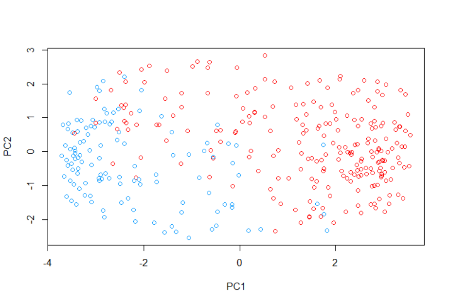
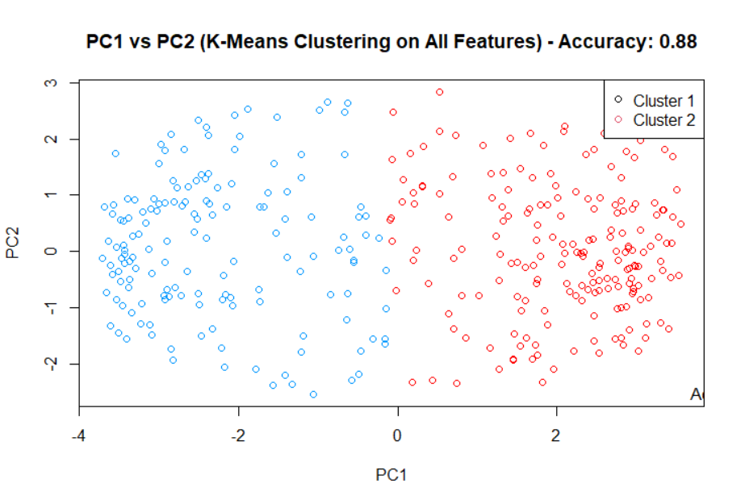
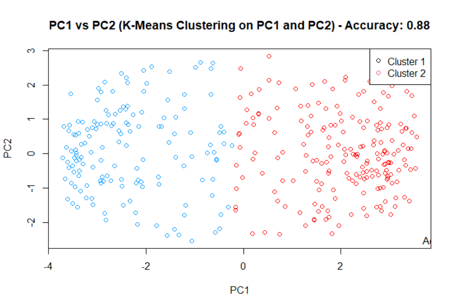

# Customer Churn Prediction & Dimensionality Reduction

[](https://www.r-project.org/)
[](LICENSE)

Two applied machine-learning analyses in R: predicting whether a telecom customer
will churn, and testing whether PCA dimensionality reduction loses information
when clustering congressional voting records.

## Key Results

**Churn prediction** (T-Mobile `mlc_churn` data, 5,000 customers, 75% train / 25% test,
test set n = 1,272):

| Model | Accuracy | Sensitivity | Specificity |
|---|---|---|---|
| Logistic regression | 72.78% | 72.79% | 72.83% |
| **Naive Bayes** | **87.58%** | 96.32% | 35.87% |
| K-nearest neighbors | 76.65% | 81.03% | 50.54% |

Naive Bayes is the most accurate churn classifier of the three, though its high
sensitivity comes with low specificity — it catches almost every churner but also
flags many customers who stay.

**PCA and k-means** (1984 U.S. House voting record, 435 members × 16 votes):

- K-means (k = 2) on the full 16-dimensional data matches the actual party labels
  with **88.28%** accuracy.
- K-means (k = 2) on PC1 and PC2 only matches them with **87.82%** accuracy.

Reducing the data to two principal components costs only **0.46 percentage points**
of clustering accuracy — PCA retains essentially all of the information that
separates the parties.

## Part 1 — T-Mobile Customer Churn Prediction

T-Mobile asked whether a customer will leave the service, based on their usage
pattern. The `mlc_churn` dataset covers **5,000 customers**: **707 churned (14.1%)**,
4,293 stayed. The models use 14 predictors — account length, international and
voice-mail plans, voice-mail messages, total day/evening/night/international
minutes, calls and charges, and number of customer-service calls. The target is
`churn`.

The data was split **75% train (3,728 customers) / 25% test (1,272 customers)**,
and three classifiers were trained on the training set and evaluated on the test
set, each with a confusion matrix, accuracy, sensitivity, and specificity:

| Model | Approach |
|---|---|
| Logistic regression | Linear model on the usage features |
| Naive Bayes | Probabilistic classifier |
| K-nearest neighbors | Distance-based classifier |

The confusion matrices and evaluation metrics are shown as R output in the
full report (`report/Churn_Prediction_Report.pdf`).

## Part 2 — PCA and K-Means on 1984 Congress Votes

Does PCA, as a dimensionality-reduction method, lose much information? The
test case is the 1984 U.S. House voting record: **435 members** (267 Republican,
168 Democrat) across **16 roll-call votes**, coded 1 = yea, −1 = nay, 0 = abstain.

- **PCA:** scatter plots of PC1 vs PC2, PC1 vs PC3, and PC2 vs PC3, with the
  PC1–PC2 plot color-coded by party — the two parties are visibly separable
  in the first two components.
- **K-means (k = 2) on the full 16-dimensional data:** clusters match the
  actual party labels with **88.28% accuracy**.
- **K-means (k = 2) on PC1 and PC2 only:** clusters match the actual party
  labels with **87.82% accuracy**.



*PC1 vs PC2 for the 1984 Congress votes, color-coded by party — the two parties
separate clearly along the first principal component.*



*K-means (k = 2) on all 16 voting features, plotted on PC1 vs PC2 — 88.28%
agreement with the actual party labels.*



*K-means (k = 2) on PC1 and PC2 only — 87.82% agreement with the actual party
labels, just 0.46 points below the full-dimensional clustering.*

Reducing the data to two principal components costs only 0.46 percentage
points of clustering accuracy, so PCA retains essentially all of the
information that separates the parties — a simpler, lower-dimensional analysis
without meaningfully compromising performance.

## How to Run

The analysis is written in R. The R scripts are not included in this repository;
the report contains the full R output, including the confusion matrices and the
PCA and k-means plots. To reproduce the analysis, run the scripts from the
repository root so the relative `data/` paths resolve, with the datasets in
`data/`:

- `data/mlc_churn.csv` — churn data for Part 1
- `data/congress_1984_votes.csv` and `data/congress_1984_party_affiliations.csv`
  — voting data and party labels for Part 2

## Repository Layout

```
├── README.md
├── LICENSE
├── images/
│   ├── pca-pc1-pc2-by-party.png   # PC1 vs PC2, color-coded by party
│   ├── kmeans-all-features.png    # K-means on all 16 votes
│   └── kmeans-pc1-pc2.png         # K-means on PC1 and PC2 only
├── code/                          # R scripts — not included (see How to Run)
├── data/
│   ├── mlc_churn.csv                          # 5,000 customers, 20 columns incl. churn
│   ├── congress_1984_votes.csv                # 435 members × 16 votes (1 / -1 / 0)
│   └── congress_1984_party_affiliations.csv   # Party label per member
└── report/
    ├── Churn_Prediction_Report.pdf
    └── Churn_Prediction_Report.docx
```

## License

MIT — see [LICENSE](LICENSE).
